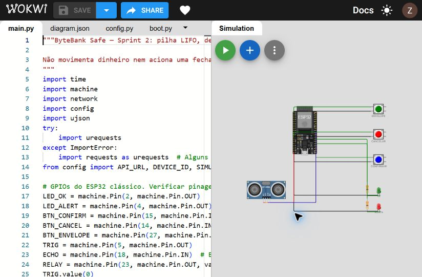
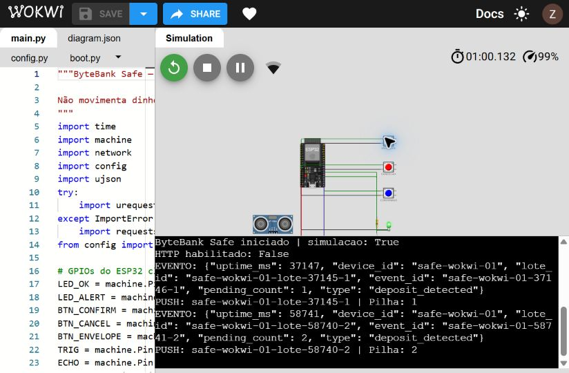
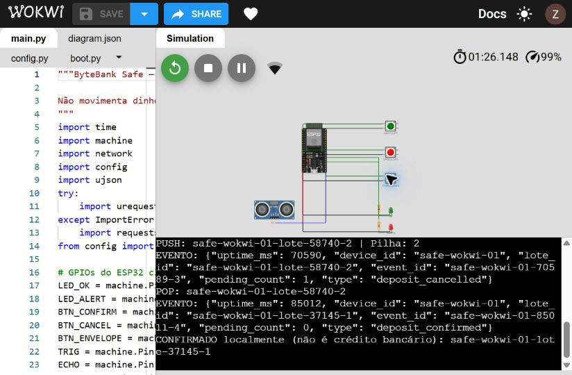
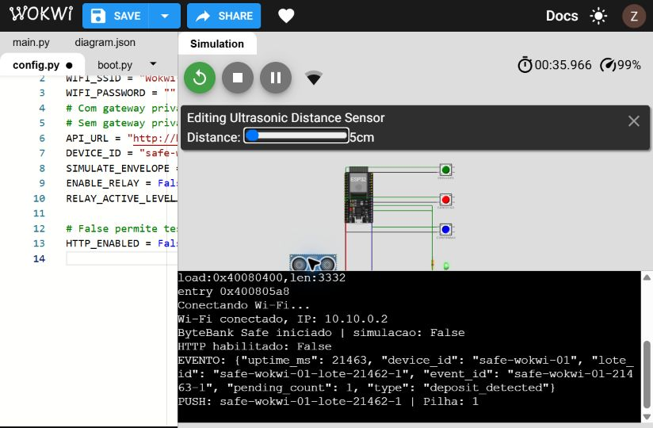
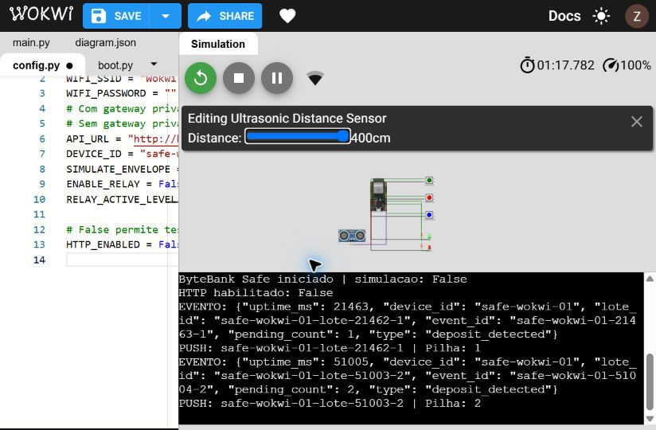
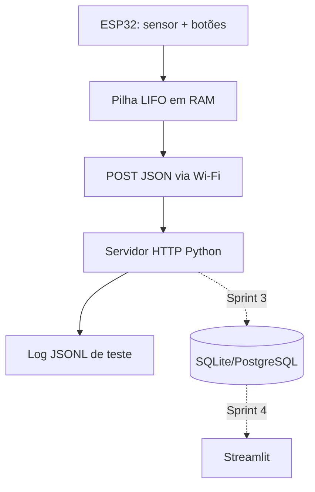

# ByteBank Safe — Cofre Inteligente

**Disciplina:** BD015 — Algoritmo e Estrutura de Dados | **Módulo 3**

**Aluno:** Zion Pedro Silva

## Entregas parciais

| Parcial | Materiais |
|---|---|
| 1 · Repositório e arquitetura | [Arquitetura em blocos](docs/arquitetura.md), [boot.py](esp32/boot.py), [evidências](docs/evidencias/README.md) |
| 2 · MicroPython e estruturas em memória | [Firmware](esp32/main.py), [relatório e bancada](docs/ENTREGA_SPRINT2.md), [Wokwi](https://wokwi.com/projects/479892016343212033) |
| 3 · API e banco relacional | [FastAPI](server/api.py), [schema.sql](schema.sql), [execução e validação](docs/ENTREGA_SPRINT3.md) |

**Bancada física:** o botão em GPIO27 com pull-up interno funcionou em teste isolado, conforme registrado pelo aluno. A foto ou o GIF do circuito completo e a confirmação do POST da placa permanecem pendentes.

## Objetivo
Detectar a entrada de envelopes no cofre, controlar lotes pendentes em uma **Pilha LIFO** (último a entrar, primeiro a cancelar), acionar LEDs e transmitir eventos via **HTTP POST + JSON** a um servidor Python de teste.

> **Importante:** projeto acadêmico de demonstração. Detecção física **não determina valor monetário** e o servidor desta sprint **não altera saldo bancário**. A Sprint 3 persiste transações, auditoria e saldo em unidades de envelopes.

## Validação executada em 05/11/2026

**Simulador público:** https://wokwi.com/projects/479892016343212033

| Item | Estado | Evidência |
|---|---|---|
| Código e diagrama | PRONTO | `esp32/` e `wokwi/` |
| Boot MicroPython e Wi-Fi virtual | TESTADO EM SIMULAÇÃO | Terminal nas capturas |
| PUSH, PUSH, POP, CONFIRMAR; contagem 1, 2, 1, 0 | TESTADO EM SIMULAÇÃO | `docs/evidencias/lifo_wokwi.txt` |
| HC-SR04: 200 → 5 → 400 → 5 → 400 cm | TESTADO EM SIMULAÇÃO | `docs/evidencias/sensor_wokwi.txt` |
| 11 testes unitários (API + firmware com periféricos substituídos) | TESTADO NO PC | `docs/evidencias/testes_pc.txt` |
| HTTP real PC: GET saúde, POST, duplicado, inválidos, GET eventos | TESTADO NO PC | `docs/evidencias/api_pc.json` |
| POST do ESP32 recebido no servidor local | PENDENTE BANCADA | Simulação sem gateway privado configurado |
| Montagem completa, sensor físico, Wi-Fi local e foto/GIF | PENDENTE BANCADA | Exige placa e peças |
| Envio pelo Classroom | PENDENTE | Vincular o repositório público no Classroom |

### Capturas reais da simulação







## Entregas / status
- [x] Código `esp32/boot.py` de Wi-Fi com timeout
- [x] Código `esp32/main.py` com LED, botões, ultrassônico opcional e pilha `append`/`pop`
- [x] Cliente HTTP usando `urequests.post()` (ou `requests` conforme firmware)
- [x] Servidor HTTP Python de teste com `POST /events`, `GET /health`, `GET /events`
- [x] Diagrama de arquitetura e pinagem documentados
- [ ] **Comprovar em bancada** Wi-Fi, leitura, envio JSON e cancelamento LIFO
- [ ] **Inserir foto/GIF verdadeiro** do circuito em `docs/evidencias/circuito.jpg`

## Arquitetura



Veja [detalhamento](docs/arquitetura.md).

## Esquema de ligação — ESP32 clássico

| Componente | GPIO | Conexão | Observação |
|---|---:|---|---|
| LED de confirmação | 2 | Anodo via resistor 220–330 Ω; catodo GND | LED integrado pode variar conforme placa |
| LED de alerta | 4 | Anodo via resistor 220–330 Ω; catodo GND | Não conectar LED sem resistor |
| Botão confirmar | 15 | Botão entre GPIO e GND | `PULL_UP` interno; GPIO15 é pino de boot em algumas placas |
| Botão cancelar | 14 | Botão entre GPIO e GND | `PULL_UP` interno |
| Botão simular envelope | 27 | Botão entre GPIO e GND | Usar `SIMULATE_ENVELOPE=True` |
| HC-SR04 TRIG | 5 | Entrada TRIG do sensor | Apenas para modo sensor |
| HC-SR04 ECHO | 18 | ECHO com divisor 5 V → 3,3 V | **NUNCA ligar ECHO 5 V diretamente no ESP32** |
| HC-SR04 VCC / GND | — | 5 V compatível / GND comum | Conferir modelo, alimentação e GND compartilhado |
| Relé (reservado) | 23 | Módulo de relé adequado | **Desativado**; não ligar solenóide diretamente ao GPIO |

**Divisor de tensão ECHO:** por exemplo, resistor 1 kΩ entre ECHO e GPIO18 e resistor 2 kΩ entre GPIO18 e GND (5 V reduzidos a aproximadamente 3,33 V). Conferir as tolerâncias/níveis do circuito. Se a bancada usar sensor diferente, ajustar a pinagem.

### Montagem em simulação

No [Wokwi ESP32](https://wokwi.com/esp32), comece com ESP32 + 3 pushbuttons + 2 LEDs + resistores. Faça botões para GND; GPIOs conforme tabela. O projeto é executável em placa real, mas a compatibilidade MicroPython, Wi-Fi e saída HTTP externa da simulação precisa ser verificada no ambiente escolhido.

### Montagem física

Para HC-SR04 real, use divisor de tensão no ECHO e desative o modo simulado. A detecção é uma transição da distância medida para menos de 10 cm. Calibre posição do sensor, distância e suporte para não duplicar detecção.

**Foto do circuito físico:** pendente. Inserir `docs/evidencias/circuito.jpg` e referenciar aqui após a montagem (não usar imagem fictícia).

## Como executar o servidor (computador, Python 3)

```bash
cd bytebank-safe-sprint2
python -m venv .venv
# Windows PowerShell:
.venv\Scripts\Activate.ps1
# Linux/macOS: source .venv/bin/activate
python -m server.app
```

O servidor HTTP, implementado apenas com a biblioteca padrão do Python, escuta em `0.0.0.0:8000` (LAN), grava `server/events.jsonl` (ignorado pelo Git) e responde a `http://localhost:8000/health`. Deixe o computador e o ESP32 na **mesma rede local**, sem isolamento de clientes; libere a porta 8000 no firewall só para a rede privada. O ESP32 deve acessar **IP LAN do computador**, não `localhost`.

### Teste rápido sem ESP32

```bash
curl -X POST http://127.0.0.1:8000/events -H "Content-Type: application/json" -d '{"event_id":"teste-001","device_id":"safe-01","type":"deposit_detected","pending_count":1,"lote_id":"lote-001"}'
```

PowerShell (alternativa independente do alias curl):

```powershell
$payload = @{event_id='teste-002';device_id='safe-01';type='deposit_detected';pending_count=1;lote_id='lote-002'} | ConvertTo-Json
Invoke-RestMethod -Uri http://127.0.0.1:8000/events -Method Post -ContentType 'application/json' -Body $payload
```

Consulte `http://localhost:8000/events` para ver eventos registrados. Os eventos duplicados (mesmo `event_id`) são reconhecidos como duplicados na API.

## Como executar no ESP32

1. Instale MicroPython na placa, seguindo o guia entregue pelo professor. **Confirme o modelo exato do ESP32 e use o firmware correspondente**. Se o firmware já estiver instalado, não precisa apagar a memória.
2. Abra o [Thonny](https://thonny.org/) (ou VS Code + MicroPico), selecione *MicroPython (ESP32)* e a porta correta.
3. Copie `esp32/config.example.py` para **`esp32/config.py`** e configure `WIFI_SSID`, `WIFI_PASSWORD`, `API_URL` (IP LAN da máquina servidor). Não publique essa versão com senha.
4. Configure `SIMULATE_ENVELOPE=True` para protótipo de botões; para HC-SR04 devidamente montado, altere para `False`.
5. Envie `config.py`, `boot.py` e `main.py` para **raiz da placa** via Thonny ou MicroPico. Use os nomes exatos.
6. Inicie o servidor no computador e reinicie a placa. Verifique no REPL o IP atribuído e os eventos.
7. Pressione **GPIO27** duas vezes, soltando entre as ações: espere `PUSH`, `PUSH`. Pressione **GPIO14**: `POP` do último lote. Pressione **GPIO15**: confirma o lote restante. O servidor deverá receber JSON para os 4 eventos.
8. Tire fotos reais do circuito e prints do REPL, API e testes; salve em `docs/evidencias/`. Atualize o checklist.

### Sem acesso ao hardware

É possível executar/testar **a API**, o POST JSON com `curl` e o algoritmo de pilha no PC; é possível também montar uma **simulação de botões** no Wokwi, conforme disponibilidade. **Não** é possível comprovar conexão real Wi-Fi, leitura real do HC-SR04, operação da trava/relé ou foto autêntica da bancada sem o hardware.

## Segurança e limitações

- Nunca publicar SSID/senha, tokens ou dados reais de clientes. `config.py` está no `.gitignore`.
- A pilha e a fila de reenvio são **voláteis em RAM**: ao reiniciar o ESP32 seus dados são perdidos. Persistência segura em flash requer projeto específico e será estudada depois.
- Não há transação financeira, autenticação bancária nem crédito de valores nesta etapa. Confirmação é **apenas confirmação local de lote**.
- O relé foi reservado em GPIO23, mas está **desabilitado** por padrão por segurança. Para demonstrar devolução física, será necessário mecanismo dedicado e projeto elétrico apropriado.
- O envio é pelo protocolo HTTP **sem criptografia**, apenas para a rede de laboratório confiável; não expor à internet.
- Se a fila de eventos atingir 50 itens, não aceita mais registros de eventos; evite continuar operação sem rede. Um protótipo bancário real precisaria armazenamento durável e garantias transacionais.
- O `event_id` combina uptime e contador; pode colidir após reboot. Para produção seria necessário identificador persistente e idempotência robusta.

## Testes

```bash
python -m unittest discover -s tests -v
```

## Histórico de evolução sugerido (commits verdadeiros)

1. `docs: especificar módulo safe, arquitetura e pinagem`
2. `feat(esp32): configurar wifi com timeout e led de status`
3. `feat(esp32): implementar pilha lifo e leitura de envelope`
4. `feat(api): receber eventos json e registrar logs de teste`
5. `test: validar ingestao, deduplicacao e entradas invalidas`
6. `docs: adicionar evidencias reais da bancada`

**Não declarar testes físicos concluídos antes de executá-los.**

## Simulação Wokwi — arquivos prontos

A pasta [`wokwi/`](wokwi/) contém `diagram.json` (componentes e fios), `main.py`, `boot.py` e `config.py`. Abra o template [MicroPython ESP32](https://wokwi.com/projects/new/micropython-esp32) e copie os arquivos seguindo [`wokwi/README.md`](wokwi/README.md).

**Diferença física importante:** na simulação, ECHO do ultrassônico está ligado diretamente ao GPIO18. Em um HC-SR04 real alimentado com 5 V, use um divisor de tensão ou conversor de nível para proteger a entrada do ESP32.


## Ajustes desta revisão

- Confirmação envia `pending_count` após a remoção lógica do topo.
- Debounce independente por botão: nível estável por 35 ms; botão segurado não repete.
- Sensor dispara abaixo de 10 cm e rearma acima de 12 cm. Timeout de eco não rearma.
- Reconexão Wi-Fi tentada a cada 10 segundos; boot trata erro de conexão e usa timeout.
- HTTP tenta a cada 5 segundos com `timeout=2`; erro preserva o evento e acende LED vermelho.
- GPIO23 é inicializado diretamente no nível inativo. O código não aciona a trava.
- Firmware MicroPython foi selecionado no `diagram.json`, com TX/RX do monitor serial.
- A versão Wokwi usa `HTTP_ENABLED=False` para demonstrar a pilha sem servidor alcançável. A versão física usa `True`. Desabilitar HTTP não desabilita a fila: após 50 eventos é necessário reiniciar a demonstração ou enviar o backlog.

### Limitações confirmadas e limites do teste

O POST é síncrono: pode atrasar a leitura de entradas durante uma tentativa. O timeout de 2 s limita a operação de socket quando suportado pelo firmware. A revisão final aceita IPv4 numérico para não executar DNS no loop. Não há captura garantida de toques muito curtos durante HTTP. Reconexão foi implementada e revisada, mas não foi provocado um corte do Wi-Fi virtual. Não há confirmação do servidor para crédito: a confirmação do botão é local. A API usa busca linear no JSONL e não autentica usuários; não expor à internet. Pilha, fila e identificadores não são duráveis após reboot. Próximas sprints: SQL/idempotência mais robusta, transações e Streamlit.

## Lista de materiais

1 ESP32 clássico com cabo USB de dados; protoboard e jumpers; 3 botões; 1 LED verde e 1 vermelho; 2 resistores de 330 Ω; 1 HC-SR04; resistores de 1 kΩ e 2 kΩ para o ECHO físico (ou conversor de nível adequado). Relé/trava ficam fora da demonstração desta revisão.

## Estrutura

- `esp32/`: firmware físico e modelo de configuração sem credenciais.
- `wokwi/`: os quatro arquivos usados na simulação pública.
- `server/`: API de laboratório e log JSONL gerado localmente.
- `tests/`: testes de API e regressões da lógica embarcada no PC.
- `docs/`: arquitetura, checklist e evidências reais.
- `examples/`: exemplos originais e demonstração simples da pilha.

## Uso de IA

Revisão, ajustes de código, automação da interface Wokwi, testes e organização da documentação realizados com auxílio do ChatGPT Work em 05/11/2026. A equipe deve estudar a lógica e validar presencialmente a montagem. Os testes no PC substituem periféricos e não comprovam desempenho no hardware físico.


### DNS e endpoint desta revisão

A tentativa real no Wokwi com `host.wokwi.internal` ficou bloqueada na resolução/conexão e só depois registrou `Servidor indisponível (evento preservado): -202`. Para evitar DNS no loop, o cliente final valida um IPv4 numérico em URL HTTP e mantém o evento na fila quando a configuração usa hostname. Na bancada use `http://IP-LAN-DO-PC:8000/events`. O endereço antigo do Wokwi é apenas marcador: com `HTTP_ENABLED=False` não é usado. Habilitá-lo com esse hostname agora produz erro local explícito, sem efetuar POST. A requisição síncrona ao IPv4 continua sujeita ao timeout de socket de 2 segundos e pode atrasar leituras. HTTPS e hostnames exigem projeto de rede posterior.
