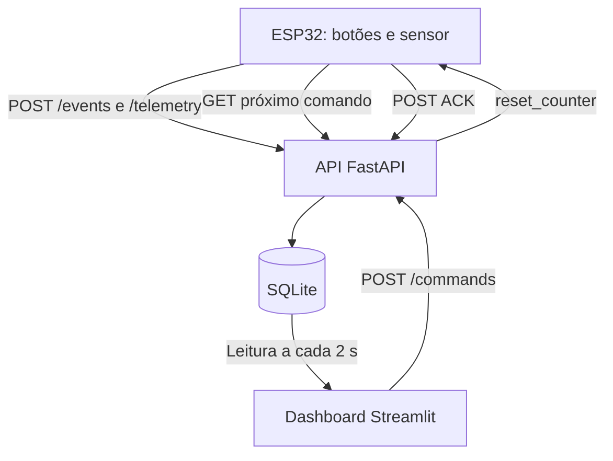

# Entrega Parcial 4 — Dashboard Streamlit e integração

Equipe: Zion Pedro Silva e Gabriel Costa. Módulo 3 — ByteBank Safe. Revisão: 19/11/2026.

## Checklist e alcance da prova

| Exigência | Implementação | Validação |
|---|---|---|
| Streamlit conectado ao banco | `dashboard/app.py` lê o mesmo SQLite da API; métricas, gráfico, eventos e comandos | Testado com Streamlit AppTest e SQLite real |
| Telemetria em tempo real | Firmware publica `/telemetry`; fragmento do Streamlit consulta a cada 2 s | Ciclo do firmware executado no PC, com HTTP real e GPIO substituído |
| Dashboard → ESP32 | Botão cria `reset_counter`; firmware consulta, executa e envia ACK | Botão real do AppTest → HTTP → lógica do firmware → SQLite → métricas |
| Fluxo sem travamentos | Rede em thread separada no firmware, timeout HTTP, consultas curtas e tratamento de indisponibilidade no painel | 19 testes passaram; API desligada não derrubou o dashboard |
| Integração com ESP32 física | ESP32 DevKit de 30 pinos com HC-SR04, botões e LEDs | Validada em bancada em 25/11/2026. Veja [o registro](evidencias/bancada-2026-11-25.md). Gravação contínua da versão final pendente. |

O teste no PC não é prova física de LEDs, sensor, rede escolar ou escalonamento das threads na ESP32. Não afirmar que a entrega está totalmente validada em bancada antes da demonstração abaixo.

## O que significa o comando

`reset_counter` zera somente o contador de diagnóstico da sessão: quantas detecções ocorreram desde o início ou o último reset. Não remove a pilha LIFO, não cancela envelopes, não apaga auditoria e não reduz o saldo em envelopes confirmados. Não há movimentação financeira nem acionamento de trava.

Estados visíveis: `pending` aguarda execução; `applied` recebeu confirmação da execução; `failed` recebeu relato de falha. O servidor entrega o mesmo comando até receber o ACK. Repetir o envio com o mesmo ID não cria outro comando. A placa mantém os últimos 16 resultados num arquivo para não reaplicar o mesmo reset após perder uma resposta; não apagar esse arquivo para resolver problemas de rede.

## Arquitetura



A UI não contém `while True`: o mecanismo `st.fragment(run_every='2s')` atualiza a parte dinâmica enquanto a sessão está aberta. O loop de botões dorme 10 ms entre leituras; sensor usa timeout de eco de 30 ms. HTTP e reconexão ficam em `_thread`, com lock apenas durante mudanças curtas de estado. Falha de rede conserva a fila de eventos. A fila RAM limita a 50 eventos e bloqueia novas alterações quando cheia. O limite não é armazenamento durável.

## Como abrir no Windows — passo a passo

1. Baixe o repositório pelo GitHub: **Code → Download ZIP**. Extraia numa pasta, por exemplo `Documentos\bytebank-safe-iot`.
2. Abra a pasta que contém `requirements.txt`. Na barra de endereço do Explorador digite `powershell` e pressione Enter.
3. Prepare o ambiente (Python 3.11 ou superior):

```powershell
py -3 -m venv .venv
.\.venv\Scripts\python.exe -m pip install -r requirements.txt
```

4. Nesse terminal inicie a API e deixe-o aberto:

```powershell
.\.venv\Scripts\python.exe -m uvicorn server.api:app --host 0.0.0.0 --port 8000
```

5. Abra `http://localhost:8000/health`. Deve indicar status `ok` e sprint 4. A API cria/atualiza o esquema no arquivo `bytebank-safe.sqlite3` sem apagar os registros da Parcial 3.
6. Abra **outro PowerShell na mesma pasta** e execute:

```powershell
.\.venv\Scripts\python.exe -m streamlit run dashboard/app.py --server.address 127.0.0.1
```

7. Abra `http://localhost:8501`. Sem placa ou simulador, o painel mostra que ainda não há telemetria. Não inventa dados.

`SAFE_DB` permite usar outro caminho de SQLite, mas precisa ser o mesmo nos dois terminais. `SAFE_API_BASE` configura o endereço da API usado pelo dashboard. Não use o servidor JSONL antigo (`python -m server.app`) nesta entrega: ele não tem banco e comandos da Parcial 4.

## Demonstrar antes de conectar a placa

Num terceiro terminal, na mesma pasta:

```powershell
.\.venv\Scripts\python.exe tools/simulate_device.py
```

O dispositivo `demo-pc` fica explicitamente marcado **SIMULAÇÃO NO PC**. Há um depósito confirmado e um contador de diagnóstico inicial igual a 1. Clique em **Resetar contador no dispositivo**, aguarde a atualização; o comando deve ficar `applied` e o contador deve ir a zero. O confirmado permanece 1. Ctrl+C encerra o simulador. Cada execução cria outro lote de demonstração; não confundir essa base com bancada física.

## Instalar na ESP32 AM-032 pelo Thonny

O MicroPython já foi instalado e o botão GPIO27 já funcionou nesta conversa; não é necessário apagar o firmware novamente.

1. Deixe relé/trava desconectados. Sem resistores, mantenha LEDs externos e HC-SR04 desconectados. É possível demonstrar a entrega usando botões, pois o contador remoto não depende deles.
2. Com USB desconectado, mantenha ENVELOPE no GPIO27/GND. Se disponíveis, CANCELAR no GPIO14/GND e CONFIRMAR no GPIO15/GND. Deixe GPIO15 solto na inicialização. Faça ligações somente pelos rótulos da placa.
3. Inicie API e dashboard como acima. No PowerShell execute `ipconfig`; identifique o IPv4 do adaptador Wi-Fi conectado. Exemplo apenas: `192.168.1.50`.
4. No PC copie `esp32/config.example.py` para `esp32/config.py`. Preencha SSID e senha locais sem publicá-los; configure:

```python
API_URL = 'http://192.168.1.50:8000/events'  # substitua pelo IPv4 real do PC
DEVICE_ID = 'safe-01'
SIMULATE_ENVELOPE = True
HTTP_ENABLED = True
ENABLE_RELAY = False
```

5. Conecte a placa. No Thonny selecione MicroPython ESP32 e a porta atual (era COM5; pode mudar). Habilite **Visualizar → Arquivos** se necessário.
6. Copie **quatro arquivos** para a raiz da ESP32: `config.py`, `boot.py`, `main.py` e **`command_state.py`**. Não envie a pasta inteira como subpasta. Não substitua o arquivo `command_ack_cache.json` gerado pela placa.
7. Reinicie com EN/Reset, sem segurar BOOT. Espere a conexão Wi-Fi no Shell. O PC e ESP32 devem estar na mesma rede; o firewall precisa permitir a porta 8000 apenas na rede privada/laboratório. Wi-Fi de escola pode isolar clientes: se não houver comunicação, peça uma rede de testes ao responsável.
8. No painel, selecione `safe-01`. Origem esperada: `esp32_buttons`. Clique no botão ENVELOPE: o contador deve subir e o evento deve aparecer na tabela. Aguarde a fila ser enviada.
9. Clique no painel em **Resetar contador no dispositivo**. Veja `pending` mudar para `applied`, o contador ir a zero e os depósitos se manterem. Se só houver um botão físico, essa demonstração ainda comprova o comando remoto; os testes completos da pilha exigem os outros botões.
10. Se o dispositivo não atualizar por mais de 15 segundos, o painel sinaliza ausência de comunicação. Verifique o Shell, o IP e a rede. Não reinstale firmware como primeira tentativa.

O cliente usa IPv4 numérico para evitar espera de DNS. A rede em thread usa recursos do ESP32 clássico; validar resposta e estabilidade no firmware instalado. HTTP é somente para LAN didática; não abrir roteador ou publicar a API. `SAFE_API_KEY` no PC e `API_KEY` no config da placa permitem uma chave opcional de laboratório; com ela, ambos os terminais e a placa precisam do mesmo valor. Não commitar a chave. Isso não fornece TLS nem segurança bancária.

## Teste end-to-end físico para filmar

1. Mostre ESP32, montagem e painel no mesmo vídeo.
2. Aperte ENVELOPE duas vezes: contador de diagnóstico 2 e dois lotes pendentes no banco.
3. Aperte CANCELAR: o último lote fica cancelado.
4. Aperte CONFIRMAR: o primeiro fica confirmado. A pilha local e o banco devem ficar sem pendentes.
5. Pelo painel envie reset; registre o ID e a transição `pending → applied`. O contador fica zero, o confirmado continua 1.
6. Pare a API; confirme que a interface permanece aberta e os botões locais ainda respondem enquanto há espaço na fila.
7. Reinicie a API, sem reiniciar a ESP32. Aguarde envio dos eventos retidos e confirme que o banco preservou o histórico.
8. Salve vídeo/capturas reais em `docs/evidencias/` sem senhas. Atualize o checklist físico somente após executar.

## Testes automáticos e evidências

```powershell
.\.venv\Scripts\python.exe -m unittest discover -s tests -v
```

Revisão de 19/11/2026: **19 testes passaram**. Veja `docs/evidencias/testes_sprint4.txt` e `e2e_sprint4.json`. O teste integrado inicia Uvicorn numa porta local, envia quatro eventos pela lógica do firmware, consulta o SQLite pelo Streamlit AppTest, clica no botão do painel, executa o ciclo de rede real do firmware no PC, verifica ACK e atualização das métricas e desliga a API para testar a falha controlada. GPIOs e Wi-Fi físicos estão substituídos; não foi feito vídeo de bancada.

Referências técnicas: https://docs.streamlit.io/develop/api-reference/execution-flow/st.fragment e https://docs.streamlit.io/develop/api-reference/app-testing/st.testing.v1.apptest . Uso de IA: implementação, revisão e testes preparados com auxílio do ChatGPT Work. Estudar o código antes da apresentação.
