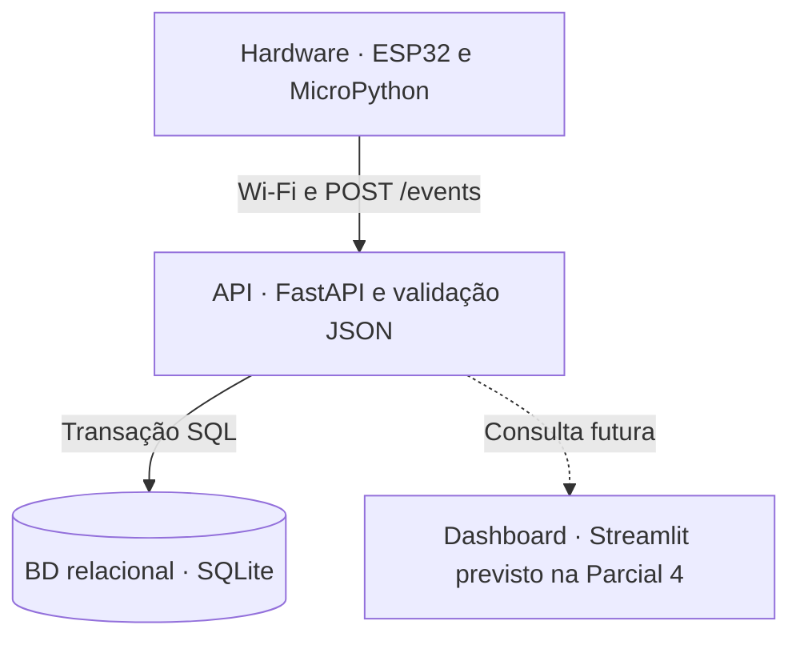

# Arquitetura em blocos

O firmware lê o HC-SR04 e os botões, sinaliza com LEDs e mantém uma pilha LIFO e uma fila de envio em RAM. Na Parcial 2, o destino é o servidor de teste em `server/app.py` com registro JSONL. Na Parcial 3, o destino usa a mesma rota POST com FastAPI e persistência relacional. O dashboard é uma etapa futura.
